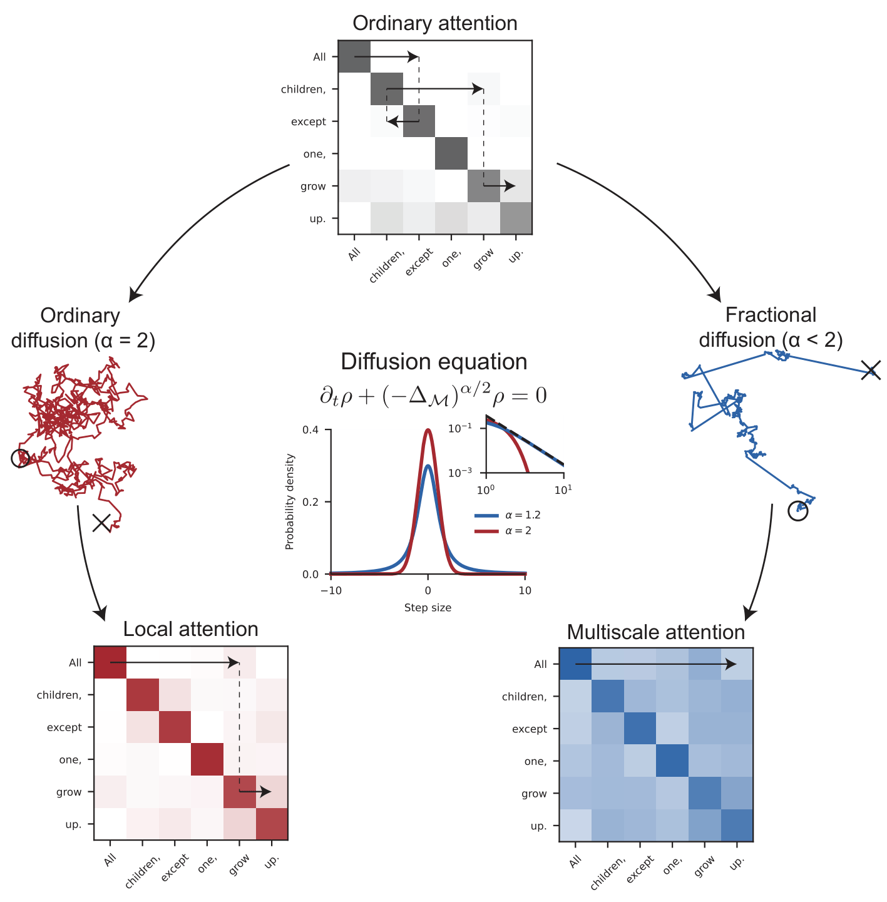

# Fractional neural attention for processing long sequences

  

## Environment information

I used `Python 3.11.13` throughout. For `nlp-tutorial` and `vit-pytorch`, the requirements are as in `requirements_fsa.txt`; for `translation` in `requirements_nmt.txt`.

## nlp-tutorial

The script `batch_exps.py` contains all the experiments ran in the manuscript, i.e. including `exps1`, `exps2`, `exps3`. These experiments can be submitted to the cluster through `batch_submit_main.py`. Otherwise, the single jobs could be ran through `main.py`.

### Experiments

1. Training models of 6 layers and 8 attention heads with Euclidean FNA (main text Fig. 7):
    - `python batch_submit_main.py --exp=exp1`
    - `python plot_results.py phase_ensembles .droot/full_models-v1mask-v7scale/6L-hidden\=256-max_len\=512-rescaled/`
2. Training models of single-layers and various embedding dimension (main text Fig. 3):
    - `python batch_submit_main.py --exp=exp2`
    - `python plot_results.py hyperparam_effects .droot/L-d-grid-v1mask-v7scaling-v2/`
3. Dynamic inference for single-layer models (main text Fig. 4):
    - `python batch_submit_main.py --exp=exp3` 
    - `python plot_results.py dynamic_inference_v2 .droot/L-d-grid-v1mask-v7scaling-v2/ False`
4. Spectral gap analysis for single-layer models (main text Fig. 5):
    - `python batch_submit_main.py --exp=exp5`
    - `python plot_mechanisms.py` (generates all subfigures of Fig. 5)
5. Attention graph analysis for single-layer models (main text Fig. 5):
    - `python batch_submit_main.py --exp=exp6`
    - `python plot_mechanisms.py` (generates all subfigures of Fig. 5, same as point 4 above)
6. Training models of 6 layers and 8 attention heads with spherical FNA (SI Fig. 2):
    - `python batch_submit_main.py --exp=exp7`
7. Diffusion maps of FNA (main text Fig. 6):
    - `python plot_dm.py`
8. Data-dependent locality (Extended Data Fig. 1):
    - `python plot_results.py dynamic_inference_v2 .droot/L-d-grid-v1mask-v7scaling-v2/ True ../.source_data/edfig1`
9. Training models of 6 layers and 8 attention heads on AG News (Extended Data Fig. 2):
    - `python batch_submit_main.py --exp=exp1` (with settings for AG News)
    - `python plot_results.py phase_ensembles .droot/full_models-v1mask-v7scale/6L-hidden\=256-max_len\=256-rescaled/ ag_news ../.source_data/edfig2`
10. Effect of train dataset size (Extended Data Fig. 3):
    - `python batch_submit_main.py --exp=exp3` 
    - `python plot_results.py trainset_pct_effects_v2 .droot`
11. Training models of 6 layers and 8 attention heads with different context windows (Extended Data Fig. 4):
    - `python batch_submit_main.py --exp=exp1` (trained on IMDb, with different context window sizes)
    - `python plot_results.py window_effects .droot/full_models-v1mask-v7scale/`
12. Trainin FNA models with different alpha values (Extended Data Fig. 5):
    - `python batch_submit_main.py --exp=exp1` (trained on IMDb, with different values of alpha and context windows)
    - `python plot_results.py window_effects .droot/full_models-v1mask-v7scale/`

## vit-pytorch

A single instance of training can be realized through:
`python main.py`

### Experiments

1. Training on CIFAR10 (main text Fig. 8):
    - `python batch_submit_vit.py --is_qsub`
    - `plot_results.py phase_ensembles .droot/full_models-final/4L-ps=4-preln/`

## translation

### Data preparation

`python -m spacy download en_core_web_sm`
`python -m spacy download de_core_news_sm`

### Train model

`python --model_name=fnsformer --alpha=1.2 --a=0 --bandwidth=1 --manifold=rd --is_rescale_dist=True --model_root=.droot/experiments --seed=0 --is_op=False --lr=0.00022 --lr_reduction_factor=0.75`

### Files to check

Double-check `modules/attention.py`
    - Can use `tests/model.py` to check things too
    - Can use `demo.py` to check translation output of model

### Experiments

1. Training on EN-DE Translational Task (Extended Data Fig. 6): 
    - `python batch_submit_main.py --is_qsub`
    - `python plot_results.py phase_ensembles .droot/full_model-warmup_cosine-lr9-sharp/l=4-h=8-d=64-ep=40/`

## schematics

1. From fractional diffusion to attention (parts of main text Fig. 1)
    - `juypter notebook _schematics/schematic_diffusion.ipynb`
2. FNA token interactions (main text Fig. 2):
    - `python _schematics/schematic_manifolds.py` 
3. PCA of token embeddings (SI Fig. 1):
    - `juypter notebook _schematics/schematic_models.ipynb`

## Code References

[1] `nlp-tutorial`, `vit-pytorch` based on https://github.com/michaelsdr/sinkformers/

[2] `translation` based on https://github.com/tanjeffreyz/attention-is-all-you-need

[3] NanoGPT: https://github.com/karpathy/nanoGPT

## Cite Our Paper

Preprint link: https://arxiv.org/abs/2511.10208 

@ARTICLE{fna_model,
       author = {{Qu}, Cheng Kevin and {Ly}, Andrew and {Gong}, Pulin},
        title = "{Fractional neural attention for efficient multiscale sequence processing}",
      journal = {arXiv e-prints},
     keywords = {Machine Learning, Artificial Intelligence, Dynamical Systems, Probability, Biological Physics},
         year = 2025,
        month = nov,
          eid = {arXiv:2511.10208},
        pages = {arXiv:2511.10208},
          doi = {10.48550/arXiv.2511.10208},
archivePrefix = {arXiv},
       eprint = {2511.10208},
 primaryClass = {stat.ML},
       adsurl = {https://ui.adsabs.harvard.edu/abs/2025arXiv251110208Q},
      adsnote = {Provided by the SAO/NASA Astrophysics Data System}
}